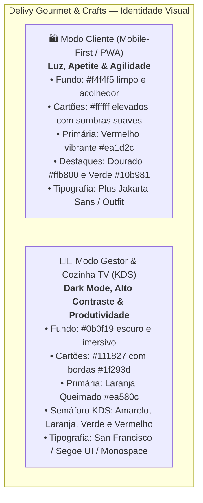
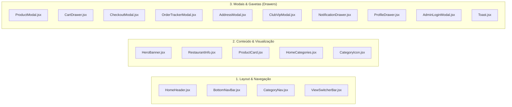
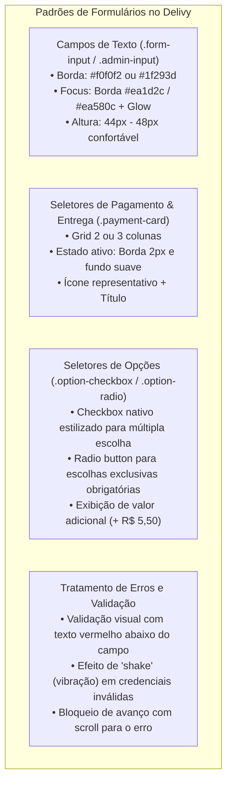

# 🎨 GUIA DO DESIGN SYSTEM & CATÁLOGO DE COMPONENTES — DELIVY

> **Projeto:** Delivy Gourmet & Crafts — Sistema Full-Stack de Delivery, Gestão de Restaurante e KDS de Cozinha  
> **Versão do Design System:** 1.0.0  
> **Data de Atualização:** 08 de Novembro de 2026  
> **Objetivo:** Documentar com precisão cirúrgica a arquitetura visual, tokens de design, biblioteca de ícones, componentes globais, padrões de formulários, estados de interface e regras de responsividade para garantir integridade e consistência visual total durante a evolução full-stack da aplicação.

---

## 1. IDENTIDADE VISUAL E DIRETRIZES GERAIS

O ecossistema **Delivy** adota uma identidade visual moderna, dinâmica e orientada à conversão, dividida em **duas linguagens visuais complementares**:



### 1.1 Filosofia Visual
- **Modo Cliente (`/`):** Inspirado nos melhores aplicativos de gastronomia (ex: iFood, Rappi Gourmet). Privilegia fotos de alta resolução dos pratos, tipografia arredondada de leitura agradável, botões de toque com áreas de clique generosas (mínimo 44x44px para mobile), feedback háptico visual (confetes no checkout, microinterações de incremento de itens) e transições suaves em gavetas inferiores e laterais.
- **Modo Gestor e Cozinha TV (`/admin`, `/cozinha`):** Desenvolvido especificamente para operação industrial de cozinhas e mesas de gestão executiva. Prioriza alto contraste para leitura à distância em telas de TV de 32" a 65", fontes monoespaçadas para comandas e valores, cores semafóricas universais para monitoramento de tempo de preparo e redução drástica da fadiga ocular.

---

## 2. PALETA DE CORES E DESIGN TOKENS

### 2.1 Tokens do Modo Cliente (`src/index.css`)

| Token CSS | Valor Hex / RGBA | Finalidade / Onde é Utilizado |
| :--- | :--- | :--- |
| `--primary` | `#ea1d2c` | Cor primária da marca: botões de ação principal, preços com destaque, badges de promoção e ícones ativos |
| `--primary-hover` | `#d31826` | Estado de foco/hover dos botões principais de compra |
| `--primary-glow` | `rgba(234, 29, 44, 0.25)` | Sombras coloridas suaves projetadas por botões em destaque |
| `--secondary` | `#ffb800` | Cor de classificação por estrelas, avaliações e itens do chef |
| `--bg-main` | `#f4f4f5` | Fundo principal da página do cardápio do cliente |
| `--bg-card` | `#ffffff` | Fundo dos cards de produto, modais e seções |
| `--bg-card-hover` | `#fafafa` | Fundo sutil ao passar o cursor sobre itens de lista |
| `--bg-glass` | `rgba(255, 255, 255, 0.95)`| Cabeçalhos fixos (`top-bar-sticky`) com efeito vidro fosco |
| `--bg-overlay` | `rgba(0, 0, 0, 0.6)` | Máscara escurecida de fundo atrás de modais e gavetas |
| `--border-color` | `#f0f0f2` | Divisórias e bordas sutis entre produtos e seções |
| `--border-highlight` | `rgba(234, 29, 44, 0.25)` | Borda ativa ao selecionar opções de pagamento ou adicionais |
| `--text-primary` | `#1f1f1f` | Texto principal, títulos de produtos e valores |
| `--text-secondary` | `#717171` | Descrições secundárias, tempo de entrega e bairros |
| `--text-muted` | `#9e9e9e` | Legendas, datas expiradas e placeholders |
| `--success` | `#10b981` | Frete grátis liberado, confirmação de PIX copiado, pedidos entregues |
| `--success-glow` | `rgba(16, 185, 129, 0.2)` | Brilho em torno de selos de sucesso |
| `--danger` | `#ef4444` | Mensagens de validação de formulário, exclusão de itens e cancelamento |

### 2.2 Tokens do Modo Gestão e Cozinha (`src/sistema_controle/sistema_controle.css`)

| Token CSS | Valor Hex / RGBA | Finalidade / Onde é Utilizado |
| :--- | :--- | :--- |
| `--admin-bg` | `#0b0f19` | Fundo escuro profundo do painel administrativo |
| `--admin-card-bg` | `#111827` | Fundo dos cards de KPI, métricas e cartões de comanda |
| `--admin-card-border`| `#1f293d` | Bordas dos cards e divisores de tabelas no painel escuro |
| `--admin-hover-bg` | `#1e293b` | Efeito de hover nas linhas de tabela e itens do menu lateral |
| `--admin-text-main` | `#f8fafc` | Texto branco de alto contraste para leitura rápida |
| `--admin-text-muted`| `#94a3b8` | Textos secundários, métricas de comparação e unidades |
| `--admin-primary` | `#ea580c` | Laranja vibrante corporativo: botões de gestão, filtros ativos e badges |
| `--admin-primary-hover`| `#c2410c` | Estado ativo do botão de gestão |
| `--admin-primary-glow` | `rgba(234, 88, 12, 0.25)` | Efeito de iluminação nos botões de destaque |
| `--kds-new` | `#eab308` | Status KDS "Recebido / Novo Pedido" (Amarelo) |
| `--kds-new-bg` | `rgba(234, 179, 8, 0.12)` | Fundo da tag e do timer do pedido recém-chegado |
| `--kds-prep` | `#f97316` | Status KDS "Em Preparo / No Fogo" (Laranja) |
| `--kds-prep-bg` | `rgba(249, 115, 22, 0.12)`| Fundo de pedidos em produção na grelha |
| `--kds-ready` | `#10b981` | Status KDS "Pronto para Entrega / Balcão" (Verde Esmeralda) |
| `--kds-ready-bg` | `rgba(16, 185, 129, 0.12)`| Fundo de pedidos finalizados pela cozinha |
| `--kds-done` | `#64748b` | Status KDS "Entregue / Concluído" (Cinza Ardósia) |
| `--status-danger` | `#ef4444` | Alerta urgente de pedido com mais de 30 minutos de atraso |
| `--status-purple` | `#8b5cf6` | Tag e distinção visual para perfil "Superadmin" e "Membro VIP" |

### 2.3 Raios de Borda (Border Radius)
- `--radius-sm`: `8px` (Inputs, botões utilitários, chips de cupons)
- `--radius-md`: `14px` (Cards de produto, campos de formulário, modais pequenos)
- `--radius-lg`: `20px` (Modais principais, gavetas com cantos superiores arredondados, hero banners)
- `--radius-full`: `9999px` (Pílulas de categoria, contadores redondos de quantidade, botões circulares)

### 2.4 Sombras e Profundidade (Box Shadows)
- `--shadow-sm`: `0 2px 8px rgba(0, 0, 0, 0.04)` (Cards em repouso)
- `--shadow-md`: `0 6px 18px rgba(0, 0, 0, 0.08)` (Cards em hover e barras de navegação fixas)
- `--shadow-lg`: `0 12px 32px rgba(0, 0, 0, 0.12)` (Modais suspensos e gavetas laterais abertas)
- `--shadow-primary`: `0 6px 20px rgba(234, 29, 44, 0.25)` (Botão de finalizar compra do cliente)

---

## 3. TIPOGRAFIA

A aplicação utiliza uma combinação tipográfica via Google Fonts importada em `src/index.css`:

```css
@import url('https://fonts.googleapis.com/css2?family=Outfit:wght@300;400;500;600;700;800&family=Plus+Jakarta+Sans:wght@400;500;600;700&display=swap');
```

### 3.1 Famílias Tipográficas
- **Família Primária (`--font-primary`):** `'Plus Jakarta Sans', 'Outfit', -apple-system, BlinkMacSystemFont, 'Segoe UI', Roboto, sans-serif`
- **Uso no Painel ADM:** Sistema de fontes nativas de alto desempenho do sistema operacional (`-apple-system, BlinkMacSystemFont, "Segoe UI", Roboto`).

### 3.2 Escala de Tamanhos e Pesos Tipográficos

| Nível / Elemento | Tamanho CSS | Peso (`font-weight`) | Altura de Linha | Casos de Uso |
| :--- | :--- | :--- | :--- | :--- |
| **Display / Tempo KDS** | `2.2rem - 2.6rem` | `800 - 900` | `1.1` | Cronômetro de minutos na Cozinha e no Rastreamento |
| **Título Principal (H1/H2)**| `1.4rem - 1.6rem` | `800 - 900` | `1.2` | Nome do Restaurante, Título da Gestão, Modais de Checkout |
| **Título de Seção (H3)** | `1.15rem - 1.25rem`| `700 - 800` | `1.3` | Seções do cardápio ("Mais Pedidos", "Destaques") |
| **Título de Item / Produto**| `0.95rem - 1.05rem`| `700` | `1.35` | Título do lanche no cardápio, nomes em listas de pedidos |
| **Corpo / Parágrafos** | `0.88rem - 0.92rem`| `400 - 500` | `1.5` | Descrições de lanches, ingredientes, mensagens do sistema |
| **Legenda / Apoio** | `0.78rem - 0.82rem`| `500 - 600` | `1.4` | Tempo de entrega ("30-45 min"), tags de bairro, endereço |
| **Micro / Badges** | `0.70rem - 0.75rem`| `700` | `1.0` | Badges de desconto ("10% OFF", "Ad", "Novo") |

---

## 4. BIBLIOTECA DE ÍCONES E SVGs PERSONALIZADOS

O projeto utiliza como biblioteca padrão e exclusiva o **`lucide-react` (v1.49.0)**, complementado por **ilustrações SVG customizadas** para gastronomia.

### 4.1 Mapeamento Completo de Ícones Lucide Utilizados

| Ícone Lucide | Arquivos Onde é Utilizado | Finalidade de Interface | Tamanhos Típicos | Cor Padrão |
| :--- | :--- | :--- | :--- | :--- |
| `Search` | `App.jsx`, `CategoryNav.jsx`, `ProdutosManager.jsx`, `UsuariosManager.jsx`, `BottomNavBar.jsx` | Campo de busca de pratos, produtos e clientes | 18px, 20px, 22px | `var(--text-secondary)`, `#94a3b8` |
| `ShoppingBag` | `HomeHeader.jsx`, `CartDrawer.jsx`, `CheckoutModal.jsx`, `SistemaControleApp.jsx` | Sacola de compras, botão flutuante e atalho para o cardápio | 16px, 18px, 22px, 36px | `var(--primary)`, `#fff` |
| `Plus` | `ProductCard.jsx`, `ProductModal.jsx`, `CartDrawer.jsx`, `AddressModal.jsx`, `ProdutosManager.jsx`, `PromocoesManager.jsx`, `ControleFinanceiro.jsx` | Adicionar produto, incrementar quantidade e abrir modais de cadastro | 11px, 13px, 18px | Herda do elemento (`currentColor`) |
| `Minus` | `ProductCard.jsx`, `ProductModal.jsx`, `CartDrawer.jsx` | Decrementar quantidade na sacola e no modal | 11px, 12px | Herda do elemento (`currentColor`) |
| `X` | `ProductModal.jsx`, `CartDrawer.jsx`, `CheckoutModal.jsx`, `OrderTrackerModal.jsx`, `AddressModal.jsx`, `AdminLoginModal.jsx` | Fechar modal ou drawer | 20px | `#94a3b8`, `var(--text-primary)` |
| `CheckCircle` / `CheckCircle2` | `Toast.jsx`, `CheckoutModal.jsx`, `OrderTrackerModal.jsx`, `ClubVipModal.jsx`, `RestaurantInfo.jsx` | Confirmação de pedido, benefício ativo e notificações | 16px, 18px, 20px | `var(--success)` (`#10b981`) |
| `Clock` | `RestaurantInfo.jsx`, `CheckoutModal.jsx`, `OrderTrackerModal.jsx`, `TelaCozinhaKDS.jsx` | Estimativa de tempo de preparo e relógio ao vivo | 15px, 18px, 20px | `var(--primary)`, `#ea580c` |
| `MapPin` | `HomeHeader.jsx`, `AddressModal.jsx`, `CheckoutModal.jsx`, `ProfileDrawer.jsx`, `RestaurantInfo.jsx` | Endereço do cliente, local de entrega e raio de distância | 15px, 16px, 20px | `var(--primary)`, `#6366f1` |
| `ChefHat` | `OrderTrackerModal.jsx`, `TelaCozinhaKDS.jsx`, `SistemaControleApp.jsx`, `ViewSwitcherBar.jsx` | Identificação da Cozinha KDS, etapa de preparo e status | 16px, 18px, 20px, 26px | `#ea580c`, `#fb923c` |
| `Bike` | `OrderTrackerModal.jsx`, `TelaCozinhaKDS.jsx` | Etapa "Em Trânsito" / Entrega por Motoboy | 18px | `var(--primary)`, `#38bdf8` |
| `Home` | `BottomNavBar.jsx`, `OrderTrackerModal.jsx` | Aba Inicial e etapa final de pedido entregue | 18px, 22px | `var(--primary)` |
| `DollarSign` | `CheckoutModal.jsx`, `PromocoesManager.jsx`, `Dashboard.jsx`, `ControleFinanceiro.jsx` | Dinheiro, faturamento total e cupom de valor fixo | 18px, 20px, 22px, 26px | `var(--success)`, `#34d399` |
| `QrCode` | `CheckoutModal.jsx` | Opção de pagamento via PIX Instantâneo | 22px | `var(--primary)` |
| `CreditCard` | `CheckoutModal.jsx`, `ProfileDrawer.jsx`, `ControleFinanceiro.jsx` | Opção de pagamento por cartão e fechamento financeiro | 20px, 22px | `var(--primary)` |
| `Trash2` | `CartDrawer.jsx`, `ProdutosManager.jsx`, `PromocoesManager.jsx`, `UsuariosManager.jsx`, `ControleFinanceiro.jsx` | Ação de excluir item, esvaziar carrinho e apagar registro | 14px, 16px, 18px | `var(--danger)` (`#ef4444`) |
| `ArrowRight` | `App.jsx`, `CartDrawer.jsx` | Indicador de prosseguir para sacola ou checkout | 18px | `#fff` |
| `ChevronDown` | `HomeHeader.jsx` | Indicador de seletor de endereço aberto | 16px | `var(--text-secondary)` |
| `ChevronLeft` / `ChevronRight` | `HeroBanner.jsx`, `RestaurantInfo.jsx`, `SistemaControleApp.jsx` | Navegação do carrossel e breadcrumbs de menu | 16px, 22px | `#fff`, `var(--text-secondary)` |
| `Bell` / `BellRing` | `HomeHeader.jsx`, `NotificationDrawer.jsx`, `TelaCozinhaKDS.jsx` | Notificações do cliente e alerta de novo pedido na cozinha | 20px | `var(--primary)`, `#ea1d2c` |
| `Gem` | `HomeHeader.jsx`, `ClubVipModal.jsx`, `ProfileDrawer.jsx` | Selo de Membro VIP do Clube Delivy | 13px, 20px | `#9333ea`, `#38bdf8` |
| `Tag` | `CategoryIcon.jsx`, `ClubVipModal.jsx`, `NotificationDrawer.jsx`, `PromocoesManager.jsx` | Cupons de desconto e categoria "Combos" | 13px, 16px, 18px, 20px, 26px | `#ea580c`, `#9333ea` |
| `Flame` | `CategoryIcon.jsx`, `NotificationDrawer.jsx`, `Dashboard.jsx` | Categoria "Mais Pedidos" e indicador de "No Fogo" | 14px, 18px, 20px | `#ea1d2c`, `#fb923c` |
| `Sparkles` | `App.jsx`, `CategoryIcon.jsx`, `ProdutosManager.jsx`, `AdminLoginModal.jsx` | Categoria "Todos", destaques e novidades | 13px, 15px, 18px | `#ea1d2c`, `#10b981` |
| `ShieldCheck` | `HomeHeader.jsx`, `ProfileDrawer.jsx`, `AdminLoginModal.jsx`, `ViewSwitcherBar.jsx` | Acesso de Administrador, Dono da Loja e Superadmin | 14px, 16px, 20px, 36px | `#ea580c`, `#f97316` |
| `Printer` | `TelaCozinhaKDS.jsx`, `ControleFinanceiro.jsx` | Impressão de comandas de cozinha e fechamento de caixa | 18px | `#fff` |
| `LayoutDashboard` | `SistemaControleApp.jsx`, `ViewSwitcherBar.jsx`, `AdminLoginModal.jsx` | Navegação para o Painel Geral do Gestor | 16px, 20px | `currentColor` |
| `LogOut` | `ViewSwitcherBar.jsx`, `ProfileDrawer.jsx` | Botão de encerramento da sessão administrativa | 15px, 20px | `var(--danger)`, `#f43f5e` |
| `Lock` | `ProfileDrawer.jsx`, `AdminLoginModal.jsx`, `ViewSwitcherBar.jsx` | Campo de senha e indicação de área restrita | 14px, 20px | `#ea580c` |
| `User` / `Users` | `BottomNavBar.jsx`, `ProfileDrawer.jsx`, `UsuariosManager.jsx`, `Dashboard.jsx` | Aba de perfil e módulo de gestão de clientes/equipe | 20px, 22px, 26px, 30px | `currentColor` |
| `MessageCircle` | `OrderTrackerModal.jsx`, `UsuariosManager.jsx` | Disparo de pedido no WhatsApp e contato com o cliente | 18px, 20px | `#25D366`, `#fff` |
| `Copy` | `OrderTrackerModal.jsx` | Copiar chave Pix Copia e Cola | 16px | `#fff` |
| `Maximize2` / `Minimize2` | `TelaCozinhaKDS.jsx` | Alternância de modo tela cheia para monitor industrial/TV | 18px | `#fff` |
| `Volume2` / `VolumeX` | `TelaCozinhaKDS.jsx` | Ativar ou mutar a campainha sonora da cozinha | 18px | `#fff`, `#ef4444` |
| `RefreshCw` | `OrderTrackerModal.jsx`, `TelaCozinhaKDS.jsx` | Fazer outro pedido ou recarregar fila de comandas | 16px, 18px | `currentColor` |

### 4.2 SVGs Customizados de Categorias (`HomeCategories.jsx`)
O componente `HomeCategories.jsx` utiliza vetores SVG artesanais para cada categoria gastronômica:
1. **`burger`:** Pão com gergelim, hambúrguer Angus, queijo cheddar derretido, tomate e folhas de alface.
2. **`pizza`:** Fatia dourada com queijo puxando, rodelas de pepperoni e folhas de manjericão.
3. **`esfiha`:** Massa folhada redonda com borda dourada, recheio de carne temperada e fatia de limão.
4. **`refrigerante`:** Lata clássica com gelo e canudo refrescante.
5. **`milkshake`:** Taça alta de morango com chantilly cremoso e cereja no topo.
6. **`soda`:** Copo long drink com fatias de frutas vermelhas e gás efervescente.
7. **`fries`:** Porção de batatas fritas douradas e crocantes em cone rústico.
8. **`dessert`:** Fatia de bolo com cobertura de calda e camadas recheadas.
9. **`combo`:** Tag de ofertas com emblema promocional.

---

## 5. CATÁLOGO DE COMPONENTES GLOBAIS E REUTILIZÁVEIS



### Componente 1: `HomeHeader`
- **Arquivo:** [`src/components/HomeHeader.jsx`](file:///c:/Users/carlo/Desktop/sistema%20delivy/src/components/HomeHeader.jsx)
- **Finalidade:** Barra superior fixa do cliente: exibe saudação, endereço atual, botão do Clube VIP, sino com badge de notificações, pílula de carrinho e botão ADM.
- **Props:**
  - `currentAddress` (string): Endereço atual selecionado.
  - `userName` (string): Nome do cliente logado/identificado.
  - `unreadNotifications` (number): Quantidade de notificações não lidas.
  - `onOpenAddress` (func): Callback para abrir `AddressModal`.
  - `onOpenClub` (func): Callback para abrir `ClubVipModal`.
  - `onOpenNotifications` (func): Callback para abrir `NotificationDrawer`.
  - `cartCount` (number): Número de itens no carrinho.
  - `cartTotal` (number): Valor financeiro do carrinho.
  - `onOpenCart` (func): Callback para abrir `CartDrawer`.
  - `onOpenAdminLogin` (func): Callback para autenticação administrativa.

### Componente 2: `ProductCard`
- **Arquivo:** [`src/components/ProductCard.jsx`](file:///c:/Users/carlo/Desktop/sistema%20delivy/src/components/ProductCard.jsx)
- **Finalidade:** Exibir produto na listagem com foto, selo/badge promocional, preço atual, preço tachado e contador/botão de adicionar.
- **Props:**
  - `product` (object): Dados do produto (`id`, `name`, `description`, `price`, `originalPrice`, `image`, `badge`, `options`).
  - `cartQty` (number): Quantidade do item no carrinho.
  - `onAddToCart` (func): Adicionar 1 unidade ao carrinho.
  - `onRemoveFromCart` (func): Decrementar quantidade.
  - `onClickCard` (func): Abrir modal de personalização detalhada.

### Componente 3: `ProductModal`
- **Arquivo:** [`src/components/ProductModal.jsx`](file:///c:/Users/carlo/Desktop/sistema%20delivy/src/components/ProductModal.jsx)
- **Finalidade:** Modal de personalização com foto em alta resolução, opções de escolha única (radio button), opcionais múltiplos pagos (checkbox), campo de observações para a cozinha e cálculo dinâmico de valor total.
- **Props:**
  - `product` (object): Produto selecionado.
  - `onClose` (func): Fechar modal.
  - `onConfirmAdd` (func): Submeter item configurado ao carrinho.
- **Estados Internos:** `quantity`, `selectedOptions`, `notes`.

### Componente 4: `CartDrawer`
- **Arquivo:** [`src/components/CartDrawer.jsx`](file:///c:/Users/carlo/Desktop/sistema%20delivy/src/components/CartDrawer.jsx)
- **Finalidade:** Gaveta lateral/inferior de compras: lista de itens com opções resumidas, alteração de quantidade individual, exclusão rápida, campo de validação de cupom de desconto, cálculo de frete e botão de checkout.
- **Props:**
  - `isOpen` (boolean): Visibilidade da gaveta.
  - `onClose` (func): Fechar gaveta.
  - `cartItems` (array): Lista de itens customizados.
  - `onUpdateQty` (func): Atualizar quantidade do item por índice.
  - `onClearCart` (func): Limpar todos os itens.
  - `onProceedToCheckout` (func): Abrir tela de pagamento.
  - `appliedCoupon` (object): Cupom ativo.
  - `setAppliedCoupon` (func): Atualizar cupom.

### Componente 5: `CheckoutModal`
- **Arquivo:** [`src/components/CheckoutModal.jsx`](file:///c:/Users/carlo/Desktop/sistema%20delivy/src/components/CheckoutModal.jsx)
- **Finalidade:** Finalização do pedido em 3 etapas estruturadas:
  1. Dados de contato (Nome e WhatsApp).
  2. Tipo de entrega (Delivery com endereço ou Retirada no Local).
  3. Método de pagamento (PIX com 5% de desconto, Cartão ou Dinheiro com campo de troco).
- **Props:** `isOpen`, `onClose`, `cartItems`, `subtotal`, `deliveryFee`, `discountAmount`, `finalTotal`, `onOrderPlaced`.
- **Efeitos:** Dispara confetes com `canvas-confetti` ao validar o pedido com sucesso.

### Componente 6: `OrderTrackerModal`
- **Arquivo:** [`src/components/OrderTrackerModal.jsx`](file:///c:/Users/carlo/Desktop/sistema%20delivy/src/components/OrderTrackerModal.jsx)
- **Finalidade:** Acompanhamento ao vivo do pedido com linha do tempo de 4 passos (`Recebido`, `Preparando`, `Em Trânsito`, `Entregue`), cronômetro de tempo estimado, código PIX com botão de copiar chave e atalho formatado para o WhatsApp do restaurante.
- **Props:** `isOpen`, `onClose`, `order`, `onNewOrder`.

### Componente 7: `CategoryNav` e `CategoryIcon`
- **Arquivos:** [`src/components/CategoryNav.jsx`](file:///c:/Users/carlo/Desktop/sistema%20delivy/src/components/CategoryNav.jsx) e [`src/components/CategoryIcon.jsx`](file:///c:/Users/carlo/Desktop/sistema%20delivy/src/components/CategoryIcon.jsx)
- **Finalidade:** Barra horizontal com rolagem suave contendo botões em formato de pílula para filtragem rápida do catálogo gastronômico.
- **Mapeamento de Ícones:** Associa nomes de categorias aos respectivos ícones do Lucide com fallbacks inteligentes.

### Componente 8: `BottomNavBar`
- **Arquivo:** [`src/components/BottomNavBar.jsx`](file:///c:/Users/carlo/Desktop/sistema%20delivy/src/components/BottomNavBar.jsx)
- **Finalidade:** Barra de navegação inferior estilo aplicativo móvel com 4 abas: **Início**, **Busca**, **Pedidos** (com badge numérico de pedidos ativos) e **Perfil** (com ponto de notificação).
- **Props:** `activeTab`, `onSelectTab`, `activeOrderCount`, `hasProfileNotification`.

### Componente 9: `Toast`
- **Arquivo:** [`src/components/Toast.jsx`](file:///c:/Users/carlo/Desktop/sistema%20delivy/src/components/Toast.jsx)
- **Finalidade:** Notificação flutuante temporizada (3 segundos) com ícone de sucesso e mensagem dinâmica.
- **Props:** `message` (string), `onClose` (func).

### Componente 10: `ViewSwitcherBar`
- **Arquivo:** [`src/sistema_controle/ViewSwitcherBar.jsx`](file:///c:/Users/carlo/Desktop/sistema%20delivy/src/sistema_controle/ViewSwitcherBar.jsx)
- **Finalidade:** Barra flutuante protegida por autenticação que permite aos gestores alternar instantaneamente entre **Cardápio**, **Cozinha TV (KDS)** e **Painel Gestor**, exibindo o nome do usuário logado e botão de logout.
- **Props:** `activeView`, `onViewChange`, `isAdmin`, `adminUser`, `onOpenLogin`, `onLogout`.

### Componente 11: `PwaInstallPrompt`
- **Arquivo:** [`src/components/PwaInstallPrompt.jsx`](file:///c:/Users/carlo/Desktop/sistema%20delivy/src/components/PwaInstallPrompt.jsx)
- **Finalidade:** Banner com regras inteligentes para convite de instalação de PWA:
  - Ignora computadores desktop.
  - Não exibe se o app já estiver instalado em modo standalone.
  - Implementa cooldown de 7 dias caso dispensado pelo usuário.
  - Suporta instruções para Safari iOS e botão nativo para Chrome Android.

---

## 6. COMPONENTES E PADRÕES DE FORMULÁRIO

Não existe uma biblioteca externa pesada de formulários (como Formik ou React Hook Form); os formulários utilizam **estados React controlados** e estilização CSS padronizada:



### 6.1 Padrão de Classes de Formulário
- `.form-group`: Container de campo com espaçamento inferior (`margin-bottom: 14px`).
- `.form-label`: Rótulo superior com `font-size: 0.85rem`, `font-weight: 600`.
- `.form-input`: Campo com altura de 44px, preenchimento interno `10px 14px`, borda suave e transição de foco.
- `.form-input:focus`: `border-color: var(--primary); outline: none; box-shadow: 0 0 0 3px var(--primary-glow)`.
- `.form-error`: Texto de alerta em vermelho com `font-size: 0.75rem` e ícone de alerta.

---

## 7. COMPONENTES DE LAYOUT E CONTAINERS

### 7.1 Container Mobile do Cliente (`.delivy-mobile-container`)
- **Largura Máxima:** `480px` centralizado em telas de desktop com borda suave e sombra sutil, simulando a tela de um smartphone moderno, ou `100%` da largura em dispositivos móveis reais.
- **Espaçamento Inferior:** `padding-bottom: 90px` garantindo que o conteúdo nunca fique oculto atrás da `BottomNavBar`.

### 7.2 Shell Administrativo (`.admin-shell`)
- **Disposição:** Flexbox bidirecional com sidebar lateral fixa (`width: 270px`) e área de conteúdo flexível (`flex: 1`).
- **Comportamento Mobile:** Sidebar recolhível em gaveta através do botão de hambúrguer na barra superior (`.admin-mobile-menu-btn`).

---

## 8. PADRÕES DE TABELAS, CARDS E LISTAGENS

### 8.1 Card de Pedido do KDS (`.kds-card`)
- **Cabeçalho:** Número do pedido em destaque (`#PED-1082`), cronômetro decorrido em minutos com cor dinâmica e tipo de entrega (Delivery ou Balcão).
- **Corpo:** Lista de itens com quantidade em negrito, opções de preparo (ex: "Ponto da Carne: Ao Ponto") e observações destacadas em caixa de texto com fundo contrastante.
- **Rodapé:** Botão de ação única para avanço de fase (`"Iniciar Preparo"`, `"Marcar como Pronto"`, `"Despachar"`) e botão de imprimir comanda térmica.

### 8.2 Grid de Produtos (`.products-grid`)
- Disposição responsiva com `grid-template-columns: repeat(auto-fill, minmax(280px, 1fr))` ou layout em coluna para telas ultra-compactas, mantendo alinhamento visual de preços e botões.

### 8.3 Tabela de Usuários e Despesas (`.admin-table`)
- Linhas horizontais com hover sutil (`var(--admin-hover-bg)`), avatares circulares de 38px, badges de cargo com cores distintas e botões de ação com ícones (Editar e Excluir).

---

## 9. ESTADOS VISUAIS (EMPTY STATES, LOADERS, HOVER, ACTIVE)

1. **Estado Vazio do Carrinho (`.empty-cart`):** Exibe ícone de sacola com opacidade reduzida, título informativo ("Seu carrinho está vazio") e texto incentivando o usuário a explorar o cardápio.
2. **Estado Vazio de Busca (`.empty-catalog-box`):** Renderiza aviso quando nenhum produto atende ao termo pesquisado.
3. **Estado de Carregamento (Loaders):** Spinner circular animado com rotação contínua em SVG ou texto "Carregando cardápio...".
4. **Estados Ativos / Selecionados:** Bordas acentuadas com a cor primária (`#ea1d2c` no cliente ou `#ea580c` no admin) e fundo com 10% de opacidade da cor tema.

---

## 10. RESPONSIVIDADE E BREAKPOINTS

| Dispositivo / Perfil | Faixa de Resolução | Comportamento do Layout |
| :--- | :--- | :--- |
| **Mobile Pequeno** | `< 380px` | Coluna única, fontes compactas, banners com proporção reduzida |
| **Mobile Padrão** | `380px - 480px` | Layout ideal do cardápio cliente, gavetas inferiores ocupam 90% da altura |
| **Tablet** | `481px - 768px` | Centralização do container do cliente; no painel ADM, sidebar oculta com botão menu |
| **Desktop / Notebook** | `769px - 1440px` | Exibição de container mobile centrado para simulação do cliente; Painel ADM com sidebar fixa |
| **TV / Telas Grandes** | `> 1440px` | Modo Cozinha KDS em grade de 3 a 4 colunas de comandas, fontes ampliadas para leitura a 3 metros |

---

## 11. ANIMAÇÕES E TRANSIÇÕES

1. **Confetes de Celebração:** Executado via `canvas-confetti` no fechamento do pedido, com 100 partículas espalhadas em arco (`y: 0.6`).
2. **Tremor de Erro (`.shake`):** Animação CSS de 600ms aplicada ao card de login administrativo quando as credenciais são rejeitadas.
3. **Ponto Verde Pulsante (`.pulse-green-dot`):** Efeito de radar piscante ao lado do status "Aberto agora" do restaurante.
4. **Deslizamento de Gavetas:** Transição suave com `transition: transform 0.3s cubic-bezier(0.16, 1, 0.3, 1)` para sensação de aplicativo nativo no iOS e Android.

---

## 12. RECOMENDAÇÕES DE ORGANIZAÇÃO E REUTILIZAÇÃO FUTURA

Para preservar a arquitetura existente sem gerar código duplicado ou quebrar estilos durante a transição Full-Stack, recomenda-se a seguinte estrutura de referência para quando novos componentes forem criados:

```
src/
├── components/
│   ├── ui/                    # Componentes atômicos e primitivos
│   │   ├── Button.jsx         # Botão primário, secundário, outline e icon-only
│   │   ├── Input.jsx          # Campo de texto com label, erro e ícone integrado
│   │   ├── Badge.jsx          # Selos promocionais e tags de status
│   │   ├── Modal.jsx          # Base genérica de modal com overlay e tecla ESC
│   │   └── Toast.jsx          # Notificações globais
│   ├── layout/                # Estrutura e navegação principal
│   │   ├── HomeHeader.jsx
│   │   ├── BottomNavBar.jsx
│   │   └── ViewSwitcherBar.jsx
│   └── shared/                # Componentes compostos de regras de negócio
│       ├── ProductCard.jsx
│       ├── CartDrawer.jsx
│       └── OrderTrackerModal.jsx
```

### Regras Mandatórias de Preservação:
- **Não alterar cores ou variáveis:** Manter estritamente as classes CSS e variáveis já consolidadas em `index.css` e `sistema_controle.css`.
- **Manter Lucide React:** Não importar outras bibliotecas de ícones (como FontAwesome, Heroicons ou React Icons).
- **Preservar a identidade visual:** Ao conectar os formulários e listagens ao Supabase, a interface visual deve permanecer 100% idêntica à experiência atual.

