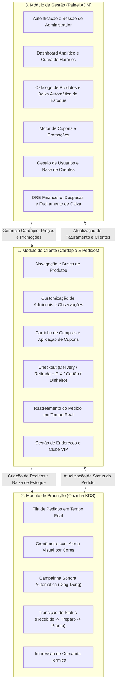
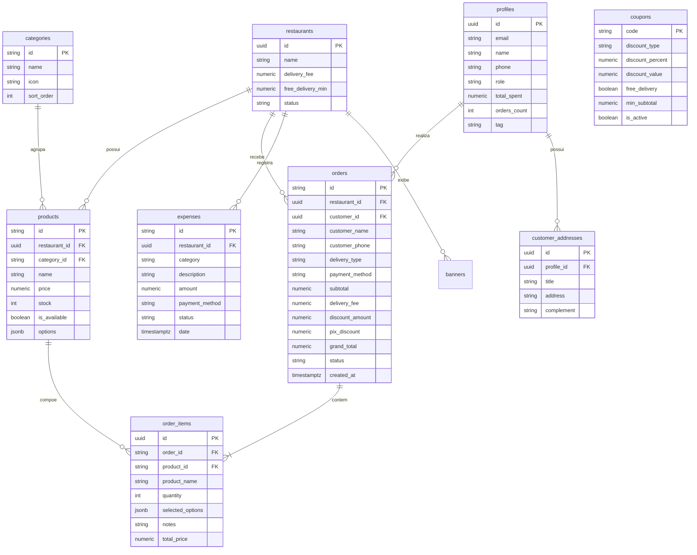
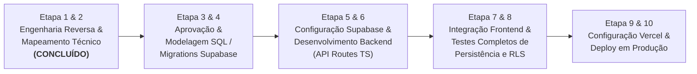

# 📋 MAPEAMENTO TÉCNICO E ENGENHARIA REVERSA — DELIVY FULL-STACK

> **Projeto:** Delivy Gourmet & Crafts — Sistema Full-Stack de Delivery, Gestão de Restaurante e KDS de Cozinha  
> **Versão do Documento:** 1.0.0  
> **Data:** 08 de Novembro de 2026  
> **Status:** Concluído para Revisão e Aprovação (Etapa 1 e 2 Concluídas)  
> **Classificação de Informações:** `[CONFIRMADO]` (código existente), `[INFERIDO]` (conclusão técnica por evidência), `[PENDENTE]` (aguardando alinhamento)

---

## 1. VISÃO GERAL

O **Delivy** é uma aplicação completa para restaurantes e operações de delivery gastronômico (hambúrgueres artesanais, pizzas, esfihas, porções, bebidas e sobremesas). O projeto foi originalmente estruturado com foco na experiência do cliente (mobile-first PWA), complementado por um subsistema robusto de retaguarda administrativa (`sistema_controle`), contendo:

1. **Cardápio Digital do Cliente (`/`):** Catálogo por categorias, personalização avançada de itens (ponto da carne, adicionais pagos, observações), sacola/carrinho persistente, cálculo automático de frete e cupons, checkout simplificado com geração de PIX Copia e Cola e direcionamento automatizado ao WhatsApp do estabelecimento, além de acompanhamento visual do pedido.
2. **Painel do Gestor / Administrador (`/admin`):** Dashboard executivo em tempo real com métricas financeiras (faturamento bruto, ticket médio, clientes atendidos, alertas de estoque baixo), gestão completa de catálogo de produtos com controle de estoque, gestão de promoções e cupons, cadastro e controle de permissões de usuários (Superadmin, Dono de Loja e Clientes VIP) e controle financeiro integrado (DRE simplificado, lançamento de despesas operacionais e impressão de fechamento de caixa).
3. **Cozinha TV - KDS (`/cozinha`):** *Kitchen Display System* projetado para TVs industriais ou monitores de produção na cozinha, com relógio ao vivo, botão de tela cheia, cronômetro progressivo de pedidos com alertas por código de cores (normal, atenção e urgente > 30min), campainha sintetizada via Web Audio API e impressão de comandas térmicas padronizadas (80mm/58mm).

Atualmente, todos os módulos funcionam no frontend consumindo dados locais simulados (`LocalStorage`, `src/data/products.js`, `store.js` e canal de comunicação entre abas via `BroadcastChannel`). O objetivo deste projeto é transformá-lo em uma solução **Full-Stack profissional**, desacoplando o estado local e conectando o ecossistema à infraestrutura em nuvem composta por **Next.js (API Routes / Vercel Functions em TypeScript)**, **Supabase PostgreSQL**, **Supabase Auth**, **Supabase Realtime**, **Supabase Storage** e **Vercel**.

---

## 2. TECNOLOGIAS E DEPENDÊNCIAS

### 2.1 Stack Frontend Identificada no Código `[CONFIRMADO]`
- **Framework:** Next.js `16.3.8` (App Router, Turbopack, React Server Components compatível)
- **Biblioteca Base:** React `19.2.8` e React-DOM `19.2.8`
- **Ícones:** `lucide-react` `^1.49.0`
- **Efeitos de Interface:** `canvas-confetti` `^1.9.4`
- **Áudio Nativo:** Web Audio API (sintetizador senoidal e harmônico no arquivo `audioNotification.js`)
- **Estilização:** CSS3 Vanilla moderno e responsivo (`src/index.css` ~90KB e `src/sistema_controle/sistema_controle.css` ~31KB) com variáveis de design system, glassmorphism e temas de alto contraste.
- **PWA:** `manifest.json`, Service Worker registrado em `public/sw.js` e componente `PwaInstallPrompt.jsx` com detecção de dispositivo mobile e cooldown de instalação.

### 2.2 Stack Alvo para o Backend e Infraestrutura `[INFERIDO]`
- **Runtime Backend:** Next.js Route Handlers (`app/api/...`) executados como Vercel Serverless Functions.
- **Linguagem Backend:** TypeScript `^5.x` com tipagem estrita para schemas, DTOs e entidades.
- **Banco de Dados:** Supabase PostgreSQL 15+.
- **ORM / Query Builder:** Prisma ORM ou Supabase JS Client (`@supabase/supabase-js`) com geração de tipos TypeScript (`supabase gen types typescript`).
- **Autenticação:** Supabase Auth (`@supabase/ssr` / JWT Tokens) para administradores e equipe de cozinha; autenticação híbrida com suporte a pedidos de convidados (Guest Checkout) para clientes finais.
- **Segurança:** PostgreSQL Row Level Security (RLS) habilitado em todas as tabelas públicas.
- **Armazenamento de Arquivos:** Supabase Storage (Buckets `products`, `avatars`, `banners`).
- **Comunicação em Tempo Real:** Supabase Realtime Channels (Postgres Changes) substituindo o `BroadcastChannel` local, garantindo sincronização entre o celular do cliente e a TV da cozinha em dispositivos e redes físicas distintas.
- **Hospedagem & CI/CD:** Vercel integrada ao repositório GitHub `https://github.com/accarlosmaciel/sistema-delivy.git`.

---

## 3. ESTRUTURA DO FRONTEND

A arquitetura do diretório existente divide-se harmonicamente entre a camada de rotas (`app/`), componentes de consumo do cliente (`src/components/`), módulo de retaguarda (`src/sistema_controle/`) e dados mestres (`src/data/`):

```
sistema-delivy/
├── app/                                 # Next.js App Router
│   ├── layout.jsx                       # Root Layout: metadados, viewport PWA e SW
│   ├── page.jsx                         # Rota '/' -> Renderiza src/App.jsx
│   ├── admin/
│   │   └── page.jsx                     # Rota '/admin' -> Painel do Gestor
│   └── cozinha/
│       └── page.jsx                     # Rota '/cozinha' -> KDS Cozinha TV
├── public/
│   ├── favicon.svg
│   ├── icons.svg
│   ├── manifest.json                    # Configuração PWA
│   ├── sw.js                            # Service Worker PWA
│   └── icons/                           # Ícones 192px e 512px
├── src/
│   ├── App.jsx                          # Orquestrador do Cardápio Cliente e Modais
│   ├── App.css
│   ├── index.css                        # Design System global do cliente
│   ├── assets/                          # Imagens e vetores
│   ├── components/                      # Componentes do Cardápio Cliente
│   │   ├── AddressModal.jsx             # Modal de seleção/cadastro de endereços
│   │   ├── BottomNavBar.jsx             # Barra de navegação inferior mobile (4 abas)
│   │   ├── CartDrawer.jsx               # Gaveta lateral do carrinho de compras
│   │   ├── CategoryIcon.jsx             # Renderizador dinâmico de ícones Lucide
│   │   ├── CategoryNav.jsx              # Pílulas de filtro de categorias
│   │   ├── CheckoutModal.jsx            # Modal de finalização de pedido em 3 etapas
│   │   ├── ClubVipModal.jsx             # Modal do Clube VIP e ativação de cupons
│   │   ├── FamousBrands.jsx             # Carrossel de marcas / lojas parceiras
│   │   ├── Header.jsx                   # Topo alternativo
│   │   ├── HeroBanner.jsx               # Carrossel animado de ofertas ("a partir de R$ 0,90")
│   │   ├── HomeCategories.jsx           # Grid horizontal de categorias ilustradas em SVG
│   │   ├── HomeHeader.jsx               # Topo principal: saudação, endereço, VIP, sino e ADM
│   │   ├── NotificationDrawer.jsx       # Gaveta lateral de avisos e promoções relâmpago
│   │   ├── OrderTrackerModal.jsx        # Modal de rastreio em tempo real com QR Code PIX e WhatsApp
│   │   ├── ProductCard.jsx              # Card de produto com imagem, badge e botão rápido +/-
│   │   ├── ProductModal.jsx             # Modal de customização de produto (adicionais, ponto, obs)
│   │   ├── ProfileDrawer.jsx            # Gaveta do perfil do usuário e atalho de login ADM
│   │   ├── PromoHighlights.jsx          # Cards coloridos de ofertas e destaques
│   │   ├── PwaInstallPrompt.jsx         # Banner de convite para instalar PWA no celular
│   │   ├── RestaurantInfo.jsx           # Capa do restaurante, métricas e barra de frete grátis
│   │   └── Toast.jsx                    # Notificação flutuante temporizada
│   ├── data/
│   │   └── products.js                  # Dados mestres e sementes mockadas
│   └── sistema_controle/               # Módulo de Gestão e Cozinha
│       ├── AdminLoginModal.jsx          # Modal de autenticação restrita para ADM e Cozinha
│       ├── audioNotification.js         # Sintetizador Web Audio API de sinos e alertas
│       ├── ControleFinanceiro.jsx       # DRE, meios de pagamento, despesas e fechamento de caixa
│       ├── Dashboard.jsx                # KPIs, faturamento, ticket médio e curva de horários
│       ├── ProdutosManager.jsx          # CRUD de produtos, fotos rápidas e ajuste de estoque
│       ├── PromocoesManager.jsx         # CRUD de cupons (percentual, fixo e frete grátis)
│       ├── SistemaControleApp.jsx        # Shell administrativo com sidebar e tabs
│       ├── sistema_controle.css         # Estilização de alto contraste e glassmorphism
│       ├── store.js                     # Store reativa local com LocalStorage e BroadcastChannel
│       ├── TelaCozinhaKDS.jsx           # Painel de produção de pedidos para TV de cozinha
│       ├── UsuariosManager.jsx          # Gestão de perfis (Superadmin, Dono de Loja e Clientes)
│       └── ViewSwitcherBar.jsx          # Barra flutuante para alternar entre Cardápio, Cozinha e Gestão
```

---

## 4. MÓDULOS DO SISTEMA



---

## 5. MAPEAMENTO DETALHADO DE TODAS AS TELAS

### Tela 1: Cardápio Principal do Cliente (`/`) `[CONFIRMADO]`
- **Objetivo:** Exibir produtos, promoções, seleção de categorias e gerenciar carrinho.
- **Componentes Renderizados:** `HomeHeader`, `HomeCategories`, `HeroBanner`, `CategoryNav`, `ProductCard`, `BottomNavBar`, `ViewSwitcherBar`, `PwaInstallPrompt`.
- **Modais e Gavetas Conectados:** `AddressModal`, `ClubVipModal`, `NotificationDrawer`, `ProfileDrawer`, `ProductModal`, `CartDrawer`, `CheckoutModal`, `OrderTrackerModal`, `AdminLoginModal`, `Toast`.
- **Necessidade de Backend:**
  - Carregar dados do restaurante (`restaurants`).
  - Carregar banners ativos (`banners`).
  - Carregar categorias cadastradas (`categories`).
  - Carregar catálogo de produtos disponíveis e estoque atual (`products`).
  - Recuperar pedido ativo do usuário por sessão/localStorage (`orders`).

### Tela 2: Modal de Customização de Produto (`ProductModal.jsx`) `[CONFIRMADO]`
- **Objetivo:** Permitir ao cliente escolher variações obrigatórias (ex: Ponto da Carne, Bebidas de Combos), marcar adicionais extras com preço e escrever observações para a cozinha.
- **Necessidade de Backend:**
  - Consultar regras de opções e adicionais persistidas com o produto (`products.options`).
  - Validar no backend se os adicionais enviados e preços calculados conferem com a tabela de preços antes da gravação do pedido.

### Tela 3: Gaveta do Carrinho (`CartDrawer.jsx`) `[CONFIRMADO]`
- **Objetivo:** Listar itens selecionados, alterar quantidades, remover itens, validar cupom de desconto promocional e exibir progresso para taxa de entrega grátis.
- **Necessidade de Backend:**
  - Endpoint de validação de cupons (`/api/coupons/validate`): checar se o cupom existe, está ativo, dentro da validade e atende ao `minSubtotal`.

### Tela 4: Modal de Finalização / Checkout (`CheckoutModal.jsx`) `[CONFIRMADO]`
- **Objetivo:** Coletar dados do cliente (Nome, WhatsApp), tipo de entrega (Delivery ou Retirada), endereço completo e método de pagamento (PIX, Cartão, Dinheiro com troco).
- **Necessidade de Backend:**
  - Endpoint de criação de pedido (`POST /api/orders`): persistir o pedido em transação atômica, salvar itens (`order_items`), decrementar estoque de cada produto e atualizar ou cadastrar o cliente na base de dados (`profiles`).

### Tela 5: Modal de Acompanhamento do Pedido (`OrderTrackerModal.jsx`) `[CONFIRMADO]`
- **Objetivo:** Exibir status atual do pedido em linha do tempo (Recebido -> Preparando -> Em Trânsito -> Entregue), estimativa em minutos, chave PIX Copia e Cola e link direto para envio da mensagem estruturada no WhatsApp do restaurante.
- **Necessidade de Backend:**
  - Consulta do pedido atual (`GET /api/orders/[id]`).
  - Assinatura Realtime no Supabase para receber mudança de status imediatamente quando a cozinha ou o motoboy atualizar o pedido.

### Tela 6: Painel do Gestor - Dashboard (`/admin` -> Aba `Dashboard.jsx`) `[CONFIRMADO]`
- **Objetivo:** Visão analítica para o dono do restaurante: faturamento total, pedidos ativos no fogão, ticket médio, produtos com estoque crítico (< 10 unidades) e curva de vendas por horário.
- **Necessidade de Backend:**
  - Endpoint agregador (`GET /api/dashboard/stats`): consultas SQL otimizadas com agregações `SUM`, `COUNT`, `AVG` e agrupamento por status.

### Tela 7: Painel do Gestor - Produtos & Estoque (`/admin` -> Aba `ProdutosManager.jsx`) `[CONFIRMADO]`
- **Objetivo:** Listar produtos, filtrar por categoria e nível de estoque, cadastrar novos produtos, editar informações, excluir produtos e alterar estoque com botões rápidos (+5 / -1).
- **Necessidade de Backend:**
  - Endpoints CRUD de produtos (`GET, POST /api/products`, `PUT, DELETE /api/products/[id]`).
  - Upload de imagens para o Supabase Storage (`/api/upload`).

### Tela 8: Painel do Gestor - Promoções & Cupons (`/admin` -> Aba `PromocoesManager.jsx`) `[CONFIRMADO]`
- **Objetivo:** Cadastrar cupons de desconto por percentual, valor fixo ou frete grátis, definindo valor mínimo de compra, e desativar/excluir cupons.
- **Necessidade de Backend:**
  - Endpoints CRUD de cupons (`GET, POST /api/coupons`, `DELETE /api/coupons/[code]`).

### Tela 9: Painel do Gestor - Clientes & Usuários (`/admin` -> Aba `UsuariosManager.jsx`) `[CONFIRMADO]`
- **Objetivo:** Gerenciar base de clientes com histórico de compras (LTV total, quantidade de pedidos, tag VIP/Recorrente/Novo, endereço) e gerenciar credenciais de administradores e equipe de cozinha.
- **Necessidade de Backend:**
  - Endpoints CRUD de usuários e clientes (`GET, POST /api/users`, `PUT, DELETE /api/users/[id]`).
  - Integração com Supabase Auth (`supabase.auth.admin`).

### Tela 10: Painel do Gestor - Controle Financeiro (`/admin` -> Aba `ControleFinanceiro.jsx`) `[CONFIRMADO]`
- **Objetivo:** Demonstrativo de resultados com Faturamento Bruto, Descontos concedidos, Despesas operacionais cadastradas, Lucro Líquido apurado, divisão por meio de pagamento (PIX, Cartão de Crédito, Débito e Dinheiro) e impressão de Fechamento de Caixa.
- **Necessidade de Backend:**
  - Endpoints CRUD de despesas (`GET, POST /api/expenses`, `DELETE /api/expenses/[id]`).
  - Relatório financeiro consolidado por período.

### Tela 11: Cozinha TV - KDS (`/cozinha` ou `TelaCozinhaKDS.jsx`) `[CONFIRMADO]`
- **Objetivo:** Exibição em grade de pedidos para a cozinha, com cronômetro em tempo real, código de cores para alertas visuais, sinal sonoro a cada novo pedido, avanço de status com um clique e impressão de comandas para impressora térmica.
- **Necessidade de Backend:**
  - Endpoint de listagem de pedidos da cozinha (`GET /api/orders?status=active`).
  - Endpoint de transição de status (`PATCH /api/orders/[id]/status`).
  - Supabase Realtime escutando eventos `INSERT` e `UPDATE` na tabela `orders`.

### Tela 12: Modal de Autenticação Administrativa (`AdminLoginModal.jsx`) `[CONFIRMADO]`
- **Objetivo:** Modal protegido com e-mail e senha para restringir o acesso à área de Gestão e Cozinha.
- **Necessidade de Backend:**
  - Endpoint de autenticação (`POST /api/auth/login`) utilizando Supabase Auth, validando permissões (`role IN ('superadmin', 'admin', 'kitchen')`) e gerando cookies seguros (`httpOnly`).

---

## 6. TODOS OS CAMPOS DE FORMULÁRIO MAPEADOS

| Tela / Componente | Campo | Tipo de Entrada | Validação Frontend Existente | Regra de Backend Necessária | Classificação |
| :--- | :--- | :--- | :--- | :--- | :--- |
| **CheckoutModal** | `name` | Texto | Obrigatório (`!formData.name.trim()`) | `z.string().min(2).max(100)` | `[CONFIRMADO]` |
| **CheckoutModal** | `phone` | Texto / Tel | Obrigatório (`!formData.phone.trim()`) | `z.string().min(10).max(20)` | `[CONFIRMADO]` |
| **CheckoutModal** | `deliveryType` | Seletor | `'delivery'` ou `'pickup'` | `z.enum(['delivery', 'pickup'])` | `[CONFIRMADO]` |
| **CheckoutModal** | `street` | Texto | Obrigatório se `deliveryType === 'delivery'` | Obrigatório se delivery | `[CONFIRMADO]` |
| **CheckoutModal** | `number` | Texto | Obrigatório se `deliveryType === 'delivery'` | Obrigatório se delivery | `[CONFIRMADO]` |
| **CheckoutModal** | `neighborhood` | Texto | Obrigatório se `deliveryType === 'delivery'` | Obrigatório se delivery | `[CONFIRMADO]` |
| **CheckoutModal** | `complement` | Texto | Opcional | Opcional (apto, bloco) | `[CONFIRMADO]` |
| **CheckoutModal** | `paymentMethod` | Seletor | `'pix'`, `'card'`, `'cash'` | `z.enum(['pix', 'card', 'cash'])` | `[CONFIRMADO]` |
| **CheckoutModal** | `changeFor` | Texto | Opcional (usado se `cash`) | Opcional | `[CONFIRMADO]` |
| **ProductModal** | `quantity` | Numérico | Mínimo 1 | `z.number().int().positive()` | `[CONFIRMADO]` |
| **ProductModal** | `selectedOptions` | Radio/Checkbox | Valida se grupo tem `required: true` | Valida compatibilidade com opções cadastradas | `[CONFIRMADO]` |
| **ProductModal** | `notes` | Textarea | Opcional | `z.string().max(300).optional()` | `[CONFIRMADO]` |
| **CartDrawer** | `couponCode` | Texto | Não vazio, compara com cupom | Checa no Supabase se ativo e válido | `[CONFIRMADO]` |
| **AddressModal** | `newAddressInput` | Texto | Não vazio | `z.string().min(5)` | `[CONFIRMADO]` |
| **AdminLoginModal**| `email` | Email | Formato email, obrigatório | Supabase Auth `signInWithPassword` | `[CONFIRMADO]` |
| **AdminLoginModal**| `password` | Password | Obrigatório | Supabase Auth `signInWithPassword` | `[CONFIRMADO]` |
| **ProdutosManager**| `name` | Texto | Obrigatório | `z.string().min(2)` | `[CONFIRMADO]` |
| **ProdutosManager**| `description` | Textarea | Opcional | `z.string().optional()` | `[CONFIRMADO]` |
| **ProdutosManager**| `price` | Decimal/Moeda| Obrigatório, float > 0 | `z.number().positive()` | `[CONFIRMADO]` |
| **ProdutosManager**| `originalPrice`| Decimal/Moeda| Opcional | `z.number().positive().optional()` | `[CONFIRMADO]` |
| **ProdutosManager**| `category` | Select | Categoria válida do catálogo | FK válida em `categories` | `[CONFIRMADO]` |
| **ProdutosManager**| `stock` | Inteiro | >= 0 | `z.number().int().min(0)` | `[CONFIRMADO]` |
| **ProdutosManager**| `image` | URL / File | URL padrão ou customizada | URL válida ou upload no Storage | `[CONFIRMADO]` |
| **ProdutosManager**| `badge` | Texto | Opcional (ex: "Novo", "Promo") | `z.string().max(30).optional()` | `[CONFIRMADO]` |
| **ProdutosManager**| `isAvailable` | Booleano | Checkbox | `z.boolean()` | `[CONFIRMADO]` |
| **ProdutosManager**| `featured` | Booleano | Checkbox | `z.boolean()` | `[CONFIRMADO]` |
| **PromocoesManager**| `couponCode` | Texto | Não vazio, maiúsculas sem espaços | PK / Código único no banco | `[CONFIRMADO]` |
| **PromocoesManager**| `discountType` | Select | `'percent'`, `'fixed'`, `'freedelivery'` | `z.enum(['percent', 'fixed', 'freedelivery'])` | `[CONFIRMADO]` |
| **PromocoesManager**| `discountValue`| Decimal | Float > 0 (percentual ou R$) | `z.number().positive()` | `[CONFIRMADO]` |
| **PromocoesManager**| `minSubtotal` | Decimal | Float >= 0 | `z.number().min(0)` | `[CONFIRMADO]` |
| **PromocoesManager**| `description` | Texto | Opcional | `z.string().optional()` | `[CONFIRMADO]` |
| **UsuariosManager** | `name` | Texto | Obrigatório | `z.string().min(2)` | `[CONFIRMADO]` |
| **UsuariosManager** | `email` | Email | Opcional para cliente, obrigatório ADM | Validação de unicidade | `[CONFIRMADO]` |
| **UsuariosManager** | `phone` | Tel | Obrigatório | Unicidade de contato | `[CONFIRMADO]` |
| **UsuariosManager** | `role` | Select | `'superadmin'`, `'admin'`, `'cliente'`, `'kitchen'` | Role autorizada no Supabase | `[CONFIRMADO]` |
| **UsuariosManager** | `address` | Texto | Opcional | `z.string().optional()` | `[CONFIRMADO]` |
| **ControleFinanc.** | `category` | Select | Categoria de despesa | `z.string()` | `[CONFIRMADO]` |
| **ControleFinanc.** | `description` | Texto | Obrigatório | `z.string().min(3)` | `[CONFIRMADO]` |
| **ControleFinanc.** | `amount` | Decimal | Obrigatório, > 0 | `z.number().positive()` | `[CONFIRMADO]` |
| **ControleFinanc.** | `paymentMethod`| Select | `'pix'`, `'boleto'`, `'credit'`, etc. | `z.string()` | `[CONFIRMADO]` |
| **ControleFinanc.** | `date` | Data | YYYY-MM-DD | Data ISO válida | `[CONFIRMADO]` |

---

## 7. TODOS OS BOTÕES E SUAS AÇÕES

### 7.1 Módulo do Cliente
1. **Adicionar Rápido (`ProductCard.jsx` - Botão `Adicionar`):** Adiciona 1 unidade ao carrinho se o item não tiver adicionais obrigatórios; caso contrário abre o `ProductModal` `[CONFIRMADO]`.
2. **Incrementar / Decrementar no Card (`ProductCard.jsx` - Botões `+` e `-`):** Ajusta quantidade do item sem customização no carrinho `[CONFIRMADO]`.
3. **Card do Produto (Clique no card):** Abre o `ProductModal` para customização detalhada de opcionais `[CONFIRMADO]`.
4. **Confirmar Personalização (`ProductModal.jsx` - Botão `Adicionar ao Pedido`):** Calcula preço unitário + extras * quantidade e insere o item estruturado no carrinho `[CONFIRMADO]`.
5. **Sacola Flutuante Mobile / Header Cart Pill:** Abre a gaveta `CartDrawer` `[CONFIRMADO]`.
6. **Esvaziar Carrinho (`CartDrawer.jsx` - Botão `Esvaziar`):** Limpa todos os itens do carrinho e remove cupom `[CONFIRMADO]`.
7. **Aplicar Cupom (`CartDrawer.jsx` e `ClubVipModal.jsx`):** Valida código do cupom e calcula desconto `[CONFIRMADO]`.
8. **Finalizar Pedido (`CartDrawer.jsx` - Botão `Finalizar Pedido`):** Fecha o carrinho e abre o `CheckoutModal` `[CONFIRMADO]`.
9. **Confirmar e Enviar Pedido (`CheckoutModal.jsx` - Botão Submit):** Valida campos, dispara confetes com `canvas-confetti`, persiste o pedido, aciona a cozinha, zera carrinho e abre o `OrderTrackerModal` `[CONFIRMADO]`.
10. **Copiar Chave PIX (`OrderTrackerModal.jsx`):** Copia payload PIX padrão BR Code para a área de transferência com feedback visual de 3 segundos `[CONFIRMADO]`.
11. **Enviar Pedido para WhatsApp (`OrderTrackerModal.jsx`):** Monta texto formatado em Markdown com itens, valores e endereço e redireciona via URL `https://wa.me/...` `[CONFIRMADO]`.
12. **Fazer Outro Pedido (`OrderTrackerModal.jsx`):** Limpa o pedido ativo da visualização e retorna ao cardápio `[CONFIRMADO]`.
13. **Seletor de Endereço (`HomeHeader.jsx` e `ProfileDrawer.jsx`):** Abre modal de endereços com seleção imediata e cadastro de novo endereço `[CONFIRMADO]`.
14. **Sino de Notificações (`HomeHeader.jsx`):** Abre drawer com novidades e cupons ativos `[CONFIRMADO]`.
15. **Clube VIP Diamond (`HomeHeader.jsx`):** Abre benefícios do clube e cupons instantâneos `[CONFIRMADO]`.
16. **Barra de Navegação Inferior (`BottomNavBar.jsx`):** Alterna entre Início, Busca, Pedidos e Perfil `[CONFIRMADO]`.
17. **Atalho ADM (`HomeHeader.jsx`, `ProfileDrawer.jsx`):** Se logado, abre `/admin`; se não, abre `AdminLoginModal` `[CONFIRMADO]`.

### 7.2 Módulo de Cozinha e Gestão
18. **Avançar Status (`TelaCozinhaKDS.jsx`):** Transita pedido de `received` -> `preparing` -> `ready` -> `completed` `[CONFIRMADO]`.
19. **Imprimir Comanda (`TelaCozinhaKDS.jsx`):** Abre janela de impressão formatada em layout térmico `[CONFIRMADO]`.
20. **Alternar Tela Cheia (`TelaCozinhaKDS.jsx`):** Executa `document.documentElement.requestFullscreen()` para TVs industriais `[CONFIRMADO]`.
21. **Ativar / Mutar Áudio (`TelaCozinhaKDS.jsx`):** Ativa ou suspende a campainha Web Audio API `[CONFIRMADO]`.
22. **Cadastrar / Salvar Produto (`ProdutosManager.jsx`):** Abre modal de produto e persiste criação ou edição `[CONFIRMADO]`.
23. **Excluir Produto (`ProdutosManager.jsx`):** Remove o produto com confirmação prévia `[CONFIRMADO]`.
24. **Ajuste Rápido de Estoque (`ProdutosManager.jsx`):** Botões `+5` e `-1` atualizam estoque em tempo real `[CONFIRMADO]`.
25. **Cadastrar Cupom (`PromocoesManager.jsx`):** Persiste novo cupom ativo no sistema `[CONFIRMADO]`.
26. **Excluir Cupom (`PromocoesManager.jsx`):** Remove cupom existente `[CONFIRMADO]`.
27. **Cadastrar / Salvar Usuário (`UsuariosManager.jsx`):** Cria ou edita perfil com atribuição de cargo `[CONFIRMADO]`.
28. **Excluir Usuário (`UsuariosManager.jsx`):** Remove usuário da base de dados `[CONFIRMADO]`.
29. **Lançar Despesa (`ControleFinanceiro.jsx`):** Registra saída de caixa categorizada `[CONFIRMADO]`.
30. **Excluir Despesa (`ControleFinanceiro.jsx`):** Deleta registro de saída `[CONFIRMADO]`.
31. **Imprimir Fechamento de Caixa (`ControleFinanceiro.jsx`):** Gera comprovante de conferência de caixa para gerência `[CONFIRMADO]`.
32. **Barra de Alternância (`ViewSwitcherBar.jsx`):** Alterna com 1 clique entre Cardápio, Cozinha KDS e Painel Gestor, além de botão de Logout `[CONFIRMADO]`.

---

## 8. REGRAS DE NEGÓCIO IDENTIFICADAS

1. **Cálculo da Taxa de Entrega:** O restaurante possui taxa fixa de R$ 4,90 e faixa de **Frete Grátis a partir de R$ 70,00** em compras de produtos. Se a opção for "Retirar no Local", a taxa de entrega é compulsoriamente R$ 0,00 `[CONFIRMADO]`.
2. **Desconto Promocional PIX:** Caso a forma de pagamento selecionada seja PIX, o sistema concede **5% de desconto imediato** sobre o valor final do pedido `[CONFIRMADO]`.
3. **Mecanismo de Cupons:**
   - Percentual: `(subtotal * percent) / 100` (ex: `DELIVY10` -> 10% OFF).
   - Fixo: abate valor fixo caso o `subtotal` alcance o valor mínimo exigido (ex: `PRIMEIRO` -> R$ 10,00 OFF em compras >= R$ 40,00).
   - Frete Grátis: zera a taxa de entrega independentemente do valor da compra (ex: `FRETEGRATIS`) `[CONFIRMADO]`.
4. **Baixa Automática de Estoque:** Ao confirmar um pedido, cada item do pedido tem sua quantidade decrementada do respectivo produto. Se o estoque atingir 0, o produto é automaticamente marcado com `isAvailable = false` `[CONFIRMADO]`.
5. **Enriquecimento Automático da Base de Clientes:** Ao registrar um pedido, o sistema localiza o cliente pelo telefone. Se já existir, incrementa o contador `ordersCount` e soma o `totalSpent`. Se o cliente atingir 4 ou mais pedidos, é automaticamente categorizado com a tag `"Cliente VIP ⭐"`; caso contrário permanece como `"Recorrente"`. Clientes inéditos são criados com a tag `"Novo"` `[CONFIRMADO]`.
6. **Ciclo de Vida do Pedido (KDS & Cliente):**
   - `received` (Recebido / Novo): Alerta sonoro duplo toca na cozinha.
   - `preparing` (Em Preparação no Fogão): Cozinha inicia produção.
   - `ready` (Pronto): Pedido embalado aguardando motoboy ou balcão.
   - `delivering` (Em Trânsito / A Caminho): Motoboy em deslocamento.
   - `completed` (Entregue / Concluído): Finalizado com sucesso.
   - `cancelled` (Cancelado): Excluído do cômputo de faturamento líquido `[CONFIRMADO]`.
7. **Código de Cores de Atraso na Cozinha:**
   - 0 a 15 minutos decorridos: Borda verde (No prazo).
   - 16 a 30 minutos: Borda amarela (Atenção).
   - Mais de 30 minutos: Borda vermelha piscante e alerta urgente (Atrasado) `[CONFIRMADO]`.
8. **Segurança de Acesso Administrativo:** Somente usuários com as roles `superadmin`, `admin` ou `kitchen` com status `ativo` podem efetuar login na retaguarda. Clientes não possuem permissão de acesso ao painel de gestão nem à tela de cozinha `[CONFIRMADO]`.

---

## 9. DADOS MOCKADOS E MAPEAMENTO PARA O SUPABASE

| Dado Mockado no Frontend | Localização Original | Tabela Supabase Destino | Estratégia de Migração |
| :--- | :--- | :--- | :--- |
| `RESTAURANT_INFO` | `src/data/products.js` | `restaurants` | Tabela única com metadados do restaurante, horários e taxas |
| `CATEGORIES` / `HOME_CATEGORIES` | `src/data/products.js` | `categories` | Tabela com nome, slug, ícone, cor e ordem de exibição |
| `HERO_BANNERS` | `src/data/products.js` | `banners` | Banners promocionais com gradientes e filtros vinculados |
| `FAMOUS_BRANDS` | `src/data/products.js` | `famous_brands` | Lista de marcas parceiras destacadas |
| `PRODUCTS` | `src/data/products.js` | `products` | Catálogo de produtos com preço, estoque, opções JSONB e fotos |
| `PROMO_COUPONS` | `src/data/products.js` | `coupons` | Tabela de cupons com regras de desconto e valores mínimos |
| `SEED_ORDERS` | `src/sistema_controle/store.js` | `orders` e `order_items` | Tabela de pedidos normalizada com itens relacionais |
| `SEED_USERS` | `src/sistema_controle/store.js` | `auth.users` e `profiles` | Contas Supabase Auth sincronizadas via Trigger com `profiles` |
| `SEED_EXPENSES` | `src/sistema_controle/store.js` | `expenses` | Registro financeiro de despesas operacionais |
| `savedAddresses` | `AddressModal.jsx` | `customer_addresses` | Endereços cadastrados pelos clientes |

---

## 10. MODELAGEM DO BANCO DE DADOS (SUPABASE POSTGRESQL)

### 10.1 Tabela `restaurants`
- `id` (UUID, PK, default `gen_random_uuid()`)
- `name` (TEXT, NOT NULL)
- `tagline` (TEXT)
- `rating` (NUMERIC(2,1), default 5.0)
- `reviews_count` (INT, default 0)
- `delivery_time` (TEXT, default '30 - 45 min')
- `delivery_fee` (NUMERIC(10,2), default 4.90)
- `free_delivery_min` (NUMERIC(10,2), default 70.00)
- `status` (TEXT, default 'Aberto')
- `opening_hours` (TEXT, default '18:00 às 23:30')
- `address` (TEXT, NOT NULL)
- `phone` (TEXT, NOT NULL)
- `banner_image` (TEXT)
- `logo_image` (TEXT)
- `created_at` (TIMESTAMPTZ, default `now()`)
- `updated_at` (TIMESTAMPTZ, default `now()`)

### 10.2 Tabela `categories`
- `id` (VARCHAR(50), PK) — ex: `'burgers'`, `'pizzas'`, `'esfihas'`
- `name` (TEXT, NOT NULL)
- `icon` (VARCHAR(50), NOT NULL) — referência ao ícone Lucide ou SVG
- `color` (VARCHAR(20))
- `badge` (VARCHAR(30))
- `sort_order` (INT, default 0)
- `is_active` (BOOLEAN, default true)
- `created_at` (TIMESTAMPTZ, default `now()`)

### 10.3 Tabela `products`
- `id` (VARCHAR(50), PK) — compatível com ids existentes (`'b1'`, `'p1'`, etc.) ou UUID
- `restaurant_id` (UUID, FK `restaurants.id` ON DELETE CASCADE)
- `category_id` (VARCHAR(50), FK `categories.id` ON DELETE SET NULL)
- `name` (TEXT, NOT NULL)
- `description` (TEXT)
- `price` (NUMERIC(10,2), NOT NULL)
- `original_price` (NUMERIC(10,2))
- `stock` (INT, default 20)
- `is_available` (BOOLEAN, default true)
- `featured` (BOOLEAN, default false)
- `badge` (TEXT)
- `image` (TEXT, NOT NULL)
- `options` (JSONB, default `'[]'::jsonb`) — estrutura completa de adicionais e escolhas
- `created_at` (TIMESTAMPTZ, default `now()`)
- `updated_at` (TIMESTAMPTZ, default `now()`)

### 10.4 Tabela `coupons`
- `code` (VARCHAR(30), PK) — uppercase (ex: `'DELIVY10'`)
- `description` (TEXT)
- `discount_type` (VARCHAR(20), NOT NULL) — `'percent'`, `'fixed'`, `'freedelivery'`
- `discount_percent` (NUMERIC(5,2))
- `discount_value` (NUMERIC(10,2))
- `free_delivery` (BOOLEAN, default false)
- `min_subtotal` (NUMERIC(10,2), default 0.00)
- `is_active` (BOOLEAN, default true)
- `expires_at` (TIMESTAMPTZ)
- `created_at` (TIMESTAMPTZ, default `now()`)

### 10.5 Tabela `profiles` (Usuários e Clientes)
- `id` (UUID, PK, FK `auth.users.id` ON DELETE CASCADE)
- `email` (TEXT, UNIQUE)
- `name` (TEXT, NOT NULL)
- `phone` (TEXT)
- `role` (VARCHAR(20), NOT NULL, default `'cliente'`) — `'superadmin'`, `'admin'`, `'kitchen'`, `'cliente'`
- `status` (VARCHAR(20), default `'ativo'`)
- `avatar` (TEXT)
- `notes` (TEXT)
- `total_spent` (NUMERIC(10,2), default 0.00)
- `orders_count` (INT, default 0)
- `tag` (VARCHAR(30), default `'Novo'`) — `'Novo'`, `'Recorrente'`, `'Cliente VIP ⭐'`
- `address` (TEXT)
- `created_at` (TIMESTAMPTZ, default `now()`)
- `updated_at` (TIMESTAMPTZ, default `now()`)

### 10.6 Tabela `orders`
- `id` (VARCHAR(30), PK) — ex: `'PED-1082'` ou `'DEL-4821'`
- `restaurant_id` (UUID, FK `restaurants.id`)
- `customer_id` (UUID, FK `profiles.id` ON DELETE SET NULL, nullable para guest checkout)
- `customer_name` (TEXT, NOT NULL)
- `customer_phone` (TEXT, NOT NULL)
- `delivery_type` (VARCHAR(20), NOT NULL) — `'delivery'` ou `'pickup'`
- `street` (TEXT)
- `number` (TEXT)
- `neighborhood` (TEXT)
- `complement` (TEXT)
- `payment_method` (VARCHAR(20), NOT NULL) — `'pix'`, `'card'`, `'cash'`
- `change_for` (TEXT)
- `subtotal` (NUMERIC(10,2), NOT NULL)
- `delivery_fee` (NUMERIC(10,2), NOT NULL, default 0.00)
- `discount_amount` (NUMERIC(10,2), default 0.00)
- `pix_discount` (NUMERIC(10,2), default 0.00)
- `grand_total` (NUMERIC(10,2), NOT NULL)
- `status` (VARCHAR(20), NOT NULL, default `'received'`) — `'received'`, `'preparing'`, `'ready'`, `'delivering'`, `'completed'`, `'cancelled'`
- `created_at` (TIMESTAMPTZ, default `now()`)
- `updated_at` (TIMESTAMPTZ, default `now()`)

### 10.7 Tabela `order_items`
- `id` (UUID, PK, default `gen_random_uuid()`)
- `order_id` (VARCHAR(30), NOT NULL, FK `orders.id` ON DELETE CASCADE)
- `product_id` (VARCHAR(50), FK `products.id` ON DELETE SET NULL)
- `product_name` (TEXT, NOT NULL)
- `product_image` (TEXT)
- `unit_price` (NUMERIC(10,2), NOT NULL)
- `quantity` (INT, NOT NULL, default 1)
- `selected_options` (JSONB)
- `notes` (TEXT)
- `total_price` (NUMERIC(10,2), NOT NULL)
- `created_at` (TIMESTAMPTZ, default `now()`)

### 10.8 Tabela `expenses` (Controle Financeiro)
- `id` (VARCHAR(50), PK, default `'exp-' || gen_random_uuid()`)
- `restaurant_id` (UUID, FK `restaurants.id`)
- `category` (VARCHAR(50), NOT NULL) — `'Insumos & Carnes'`, `'Embalagens'`, `'Logística & Entregadores'`, `'Marketing'`, etc.
- `description` (TEXT, NOT NULL)
- `amount` (NUMERIC(10,2), NOT NULL)
- `type` (VARCHAR(20), default `'despesa'`)
- `payment_method` (VARCHAR(30), default `'pix'`)
- `status` (VARCHAR(20), default `'pago'`)
- `date` (TIMESTAMPTZ, NOT NULL, default `now()`)
- `created_at` (TIMESTAMPTZ, default `now()`)

### 10.9 Tabela `banners`
- `id` (VARCHAR(50), PK)
- `title` (TEXT, NOT NULL)
- `subtitle` (TEXT)
- `price` (TEXT)
- `currency` (TEXT)
- `bg_gradient` (TEXT)
- `secondary_bg` (TEXT)
- `items_filter` (VARCHAR(50))
- `image` (TEXT)
- `food_photos` (JSONB)
- `is_active` (BOOLEAN, default true)
- `sort_order` (INT, default 0)
- `created_at` (TIMESTAMPTZ, default `now()`)

---

## 11. DIAGRAMA ENTIDADE-RELACIONAMENTO (ER)



---

## 12. ARQUITETURA BACKEND (VERCEL FUNCTIONS / NEXT.JS API ROUTES)

A arquitetura respeita o padrão Next.js App Router utilizando TypeScript modular:

```
src/
├── lib/
│   ├── supabase/
│   │   ├── client.ts          # Cliente Supabase seguro para browser (Anon Key)
│   │   ├── server.ts          # Cliente Supabase para Server Components e Route Handlers (Cookies / JWT)
│   │   └── admin.ts           # Cliente privilegiado com SERVICE_ROLE_KEY (exclusivo para Server-side seguro)
│   └── prisma.ts              # (Opcional caso Prisma seja adotado)
├── services/                  # Camada de lógica de negócios isolada dos componentes React
│   ├── productService.ts      # Consultas de cardápio, estoque e validações
│   ├── orderService.ts        # Criação transacional de pedidos, baixa de estoque e métricas
│   ├── couponService.ts       # Validação e cálculo de regras de desconto
│   ├── financeService.ts      # Apuração de DRE, receitas e despesas
│   └── userService.ts         # Perfis, promoções de cargos e sincronização
├── types/
│   ├── database.ts            # Tipagens geradas do PostgreSQL / Supabase
│   └── index.ts               # DTOs, schemas de entrada e interfaces
app/
├── api/
│   ├── auth/
│   │   ├── login/route.ts     # POST: Autenticação via Supabase Auth
│   │   ├── logout/route.ts    # POST: Encerramento de sessão
│   │   └── me/route.ts        # GET: Sessão do usuário logado
│   ├── products/
│   │   ├── route.ts           # GET: Listar produtos | POST: Criar produto
│   │   └── [id]/route.ts      # PUT: Atualizar produto | DELETE: Excluir produto
│   ├── categories/
│   │   └── route.ts           # GET: Listar categorias
│   ├── coupons/
│   │   ├── route.ts           # GET: Listar | POST: Criar cupom
│   │   ├── [code]/route.ts    # DELETE: Excluir cupom
│   │   └── validate/route.ts  # POST: Validar cupom no carrinho
│   ├── orders/
│   │   ├── route.ts           # GET: Listar pedidos (filtros) | POST: Criar novo pedido
│   │   ├── [id]/route.ts      # GET: Detalhes do pedido
│   │   └── [id]/status/route.ts # PATCH: Alterar status do pedido (KDS)
│   ├── expenses/
│   │   ├── route.ts           # GET: Listar despesas | POST: Criar despesa
│   │   └── [id]/route.ts      # DELETE: Excluir despesa
│   ├── users/
│   │   ├── route.ts           # GET: Listar usuários | POST: Cadastrar
│   │   └── [id]/route.ts      # PUT: Atualizar usuário | DELETE: Excluir
│   ├── dashboard/
│   │   └── stats/route.ts     # GET: Métricas e KPIs agregados
│   └── restaurant/
│       └── route.ts           # GET: Obter dados da loja | PUT: Atualizar
```

---

## 13. ENDPOINTS REST ESPECIFICADOS

### 13.1 Produtos
- `GET /api/products`: Lista todos os produtos disponíveis (suporta query params: `category`, `search`, `featured`).
- `POST /api/products`: Cria novo produto com validação de payload Zod (requer role `admin` ou `superadmin`).
- `PUT /api/products/[id]`: Atualiza dados ou ajusta estoque numérico (requer `admin`).
- `DELETE /api/products/[id]`: Remove produto do cardápio (requer `admin`).

### 13.2 Pedidos e Cozinha KDS
- `POST /api/orders`: Cria novo pedido com transação segura:
  1. Valida itens e recalcula subtotais no backend para evitar adulteração de preço no client.
  2. Valida cupom caso informado.
  3. Insere registro na tabela `orders`.
  4. Insere registros filhos na tabela `order_items`.
  5. Decrementa o estoque de cada produto em `products`.
  6. Atualiza ou insere o cliente em `profiles`.
  7. Dispara notificação no Supabase Realtime para a Cozinha TV.
- `GET /api/orders`: Lista histórico de pedidos com paginação e filtros (`status=active`, `status=completed`, `customer_id=...`).
- `GET /api/orders/[id]`: Retorna detalhes completos do pedido para a tela de rastreamento do cliente.
- `PATCH /api/orders/[id]/status`: Atualiza status do pedido (`received`, `preparing`, `ready`, `delivering`, `completed`, `cancelled`) — restrito a `kitchen`, `admin`, `superadmin`.

### 13.3 Cupons
- `POST /api/coupons/validate`: Recebe `{ code, subtotal }` e retorna status de validação, valor do desconto e frete grátis.
- `GET /api/coupons`: Lista cupons ativos.
- `POST /api/coupons`: Cadastra novo cupom (requer `admin`).
- `DELETE /api/coupons/[code]`: Desativa/remove cupom (requer `admin`).

### 13.4 Finanças e Dashboard
- `GET /api/dashboard/stats`: Retorna total faturado, pedidos no fogão, ticket médio, produtos com estoque baixo e distribuição por hora.
- `GET /api/expenses`: Lista despesas operacionais.
- `POST /api/expenses`: Registra nova despesa (requer `admin`).
- `DELETE /api/expenses/[id]`: Exclui despesa (requer `admin`).

---

## 14. AUTENTICAÇÃO E GESTÃO DE SESSÃO

1. **Camada de Administradores e Cozinha:**
   - Supabase Auth nativo baseado em E-mail e Senha.
   - Perfis pré-semeados no banco de dados para os 3 perfis operacionais identificados no código:
     - `superadmin@delivy.com.br` -> Role `superadmin`
     - `roberto@delivygourmet.com` -> Role `admin`
     - `cozinha@delivygourmet.com` -> Role `kitchen`
   - Armazenamento de sessão seguro via cookies `httpOnly` utilizando `@supabase/ssr`.

2. **Camada de Clientes (Experiência Sem Atrito):**
   - Suporte completo ao **Guest Checkout** comprovado no código: o cliente informa Nome e WhatsApp no `CheckoutModal` sem precisar criar senha ou passar por verificação de e-mail antes de comer.
   - O pedido fica vinculado ao número de telefone do cliente e salvo no `LocalStorage` do dispositivo para rastreamento imediato.
   - Opcionalmente, o cliente pode se cadastrar no Clube VIP criando login oficial com Supabase Auth.

---

## 15. PERMISSÕES E MATRIZ DE ACESSO (RBAC)

| Módulo / Funcionalidade | Visitante / Cliente Anônimo | Cliente Cadastrado | Equipe Cozinha (`kitchen`) | Dono da Loja (`admin`) | Master (`superadmin`) |
| :--- | :---: | :---: | :---: | :---: | :---: |
| Visualizar Cardápio e Preços | ✅ | ✅ | ✅ | ✅ | ✅ |
| Customizar e Adicionar ao Carrinho | ✅ | ✅ | ✅ | ✅ | ✅ |
| Realizar Pedido (Checkout) | ✅ | ✅ | ❌ | ❌ | ❌ |
| Rastrear Próprio Pedido | ✅ (pelo ID) | ✅ | ❌ | ✅ | ✅ |
| Visualizar Tela Cozinha KDS | ❌ | ❌ | ✅ | ✅ | ✅ |
| Mudar Status de Pedido no KDS | ❌ | ❌ | ✅ | ✅ | ✅ |
| Acessar Painel Gestor (`/admin`)| ❌ | ❌ | ❌ | ✅ | ✅ |
| Cadastrar / Editar Produtos e Estoque | ❌ | ❌ | ❌ | ✅ | ✅ |
| Cadastrar Cupons Promocionais | ❌ | ❌ | ❌ | ✅ | ✅ |
| Visualizar DRE e Lançar Despesas | ❌ | ❌ | ❌ | ✅ | ✅ |
| Gerenciar Usuários e Cargos | ❌ | ❌ | ❌ | ⚠️ (apenas loja) | ✅ (global) |

---

## 16. POLÍTICAS ROW LEVEL SECURITY (RLS)

O Row Level Security do PostgreSQL será ativado obrigatoriamente em todas as tabelas:

1. **Tabelas `products`, `categories`, `coupons`, `restaurants`, `banners`:**
   - **SELECT:** `true` (público para todos os usuários).
   - **INSERT, UPDATE, DELETE:** `auth.uid() IN (SELECT id FROM profiles WHERE role IN ('admin', 'superadmin') AND status = 'ativo')`.

2. **Tabela `orders`:**
   - **INSERT:** `true` (permite checkout anônimo do cliente).
   - **SELECT:** 
     - Usuário anônimo/cliente: pode consultar se possuir o `id` exato do pedido (via Service Role / Handler de API) ou se `customer_id = auth.uid()`.
     - Administradores / Cozinha: `auth.uid() IN (SELECT id FROM profiles WHERE role IN ('kitchen', 'admin', 'superadmin'))`.
   - **UPDATE:** `auth.uid() IN (SELECT id FROM profiles WHERE role IN ('kitchen', 'admin', 'superadmin'))`.

3. **Tabela `order_items`:**
   - Segue as mesmas diretrizes da tabela pai `orders`.

4. **Tabela `expenses`:**
   - **ALL (SELECT, INSERT, UPDATE, DELETE):** `auth.uid() IN (SELECT id FROM profiles WHERE role IN ('admin', 'superadmin'))`.

5. **Tabela `profiles`:**
   - **SELECT:** O próprio usuário (`id = auth.uid()`) ou gestores com role `admin` / `superadmin`.
   - **UPDATE:** O próprio usuário nos campos cadastrais (`name`, `phone`, `avatar`) ou gestores para alteração de status/cargos.

---

## 17. INTEGRAÇÕES EXTERNAS

1. **WhatsApp API (wa.me):** Integração direta sem dependência de APIs pagas de terceiros, construindo o link estruturado `https://wa.me/5511998765432?text=...` contendo os dados do pedido codificados em URI `[CONFIRMADO]`.
2. **PIX Instantâneo:** Geração de Payload PIX padrão Banco Central (EMV QRCPS / BR Code) "Copia e Cola" exibido no rastreador do pedido `[CONFIRMADO]`.
3. **Web Audio API:** Sintetizador sonoro integrado nativamente ao navegador para notificações na TV da cozinha sem necessidade de arquivos MP3 externos `[CONFIRMADO]`.
4. **Impressora Térmica:** Geração de documento padronizado em janela pop-up dedicada para impressão em bobinas térmicas de 80mm ou 58mm `[CONFIRMADO]`.
5. **Supabase Realtime:** Canal WebSocket gerenciado para sincronização instantânea de novos pedidos e atualizações de status `[INFERIDO]`.
6. **Vercel Hosting:** Deploy automatizado conectado ao repositório GitHub `[INFERIDO]`.

---

## 18. SEGURANÇA E CONFORMIDADE

- **Isolamento de Credenciais:** `SUPABASE_SERVICE_ROLE_KEY` será restrita estritamente ao ambiente do servidor Next.js (`server.ts` e Serverless Functions). O frontend acessará o Supabase exclusivamente com a chave pública anônima (`NEXT_PUBLIC_SUPABASE_ANON_KEY`) submetida às políticas RLS.
- **Validação de Entrada e Prevenção de Fraudes:** Todos os cálculos sensíveis (subtotal, desconto percentual de cupom, desconto de 5% no PIX, taxa de entrega grátis e total líquido) serão recalculados e validados no backend no momento do fechamento do pedido, rejeitando qualquer tentativa de manipulação via payload HTTP.
- **Sanitização de Dados:** Sanitização contra injeção SQL nativa (via queries parametrizadas do Supabase/Prisma) e proteção contra XSS nos campos de observações e nomes.
- **Segurança de Sessão:** Cookies de sessão com flags `HttpOnly`, `Secure` e `SameSite=Lax`.

---

## 19. PONTOS PENDENTES E DECISÕES ARQUITETURAIS

Abaixo estão os pontos técnicos identificados durante a engenharia reversa que exigem validação prévia:

1. **Decisão sobre Cliente Anônimo vs Cadastro Obrigatório:**  
   *Situação Atual:* O frontend permite que qualquer pessoa faça pedido informando apenas Nome e Telefone WhatsApp (`CheckoutModal.jsx`), armazenando o histórico localmente.  
   *Recomendação:* **Manter o fluxo sem atrito (Guest Checkout)** para maximizar conversões de vendas, criando o registro do cliente automaticamente na tabela `profiles`. Usuários que desejarem benefícios VIP poderão cadastrar senha opcionalmente.  
   *Classificação:* `[PENDENTE - AGUARDANDO APROVAÇÃO]`

2. **Decisão sobre Camada ORM:**  
   *Opção A (Recomendada):* Utilizar o SDK oficial `@supabase/supabase-js` em TypeScript tipado. Evita o overhead de sincronização do Prisma Engine no ambiente Vercel Serverless, mantendo o bundle leve e alta compatibilidade com RLS e Realtime.  
   *Opção B:* Adotar Prisma ORM gerando o client para o PostgreSQL do Supabase.  
   *Classificação:* `[PENDENTE - AGUARDANDO APROVAÇÃO]`

3. **Arquitetura Multi-loja (Multi-tenant):**  
   *Situação Atual:* O código possui um usuário `u-superadmin` com nota de "Acesso Multi-Lojas", porém há apenas um restaurante fixo cadastrado (`Delivy Gourmet & Crafts`).  
   *Recomendação:* Modelar todas as tabelas contendo a coluna `restaurant_id UUID`, definindo como padrão o ID da loja "Delivy Gourmet". Isso torna o sistema imediatamente pronto para multi-loja no futuro sem complexidade desnecessária agora.  
   *Classificação:* `[PENDENTE - AGUARDANDO APROVAÇÃO]`

4. **Credenciais Reais de Produção:**  
   *Situação Atual:* O projeto precisa ser vinculado ao projeto Supabase do usuário e publicado na Vercel.  
   *Ação:* Criaremos o `.env.example` completo com todos os parâmetros necessários (`NEXT_PUBLIC_SUPABASE_URL`, `NEXT_PUBLIC_SUPABASE_ANON_KEY`, `SUPABASE_SERVICE_ROLE_KEY`, etc.) e detalharemos no `DEPLOY.md` o passo a passo exato para provisionamento.  
   *Classificação:* `[CONFIRMADO]`

---

## 20. ROADMAP DE IMPLEMENTAÇÃO



- **Fase 1 (Atual - Concluída):** Engenharia reversa integral do frontend, componentes, fluxos e geração deste `MAPEAMENTO_TECNICO.md`.
- **Fase 2 (Próxima):** Revisão e aprovação do usuário sobre as decisões arquiteturais.
- **Fase 3:** Criação dos scripts SQL executáveis (`001_initial_schema.sql`, `002_rls_policies.sql`, `003_functions_triggers.sql`, `seed.sql`) estruturados para o Supabase.
- **Fase 4:** Desenvolvimento dos serviços backend, clientes Supabase em TypeScript e Route Handlers da API Next.js.
- **Fase 5:** Integração da interface React existente com os endpoints reais, substituindo gradualmente os dados de `store.js` e `products.js`.
- **Fase 6:** Testes locais ponta a ponta (criação de pedido -> recepção no KDS -> atualização de estoque -> cálculo financeiro).
- **Fase 7:** Elaboração de `DEPLOY.md`, `.env.example` e `CHECKLIST_TESTES.md`.
- **Fase 8:** Deploy na Vercel e validação final em produção.

